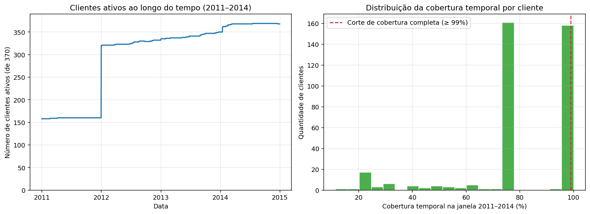
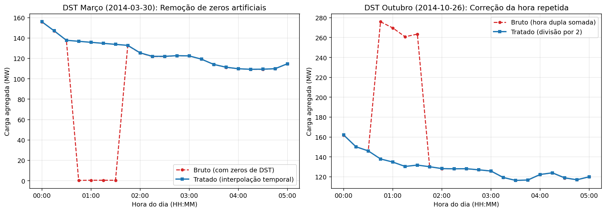

# Relatório Técnico — Mineração de Dados Temporais e Modelagem Preditiva

---

## 1. Introdução e objetivo

Este trabalho apresenta a construção e a execução de um pipeline completo de mineração de dados temporais e modelagem preditiva sobre séries reais de consumo elétrico. O estudo cumpre quatro macroetapas metodológicas:

1. **Preparação e tratamento dos dados:** auditoria da base bruta, tratamento de zeros estruturais, correção de anomalias de horário de verão (*Daylight Saving Time* — DST), interpolação temporal de falhas curtas e regularização de índice (`DatetimeIndex`).
2. **Agrupamento de séries temporais (Etapa 1):** cálculo de matriz de dissimilaridade via *Dynamic Time Warping* (DTW), agrupamento hierárquico aglomerativo (AGNES) e determinação objetiva do número de grupos *k* via Coeficiente de Silhueta.
3. **Descoberta de padrões e anomalias (Etapa 2):** aplicação de *Matrix Profile* (`stumpy`) em série representativa para identificar *motifs* e *discords*, avaliando o impacto da normalização Z-score.
4. **Modelagem preditiva (Etapa 3):** análise de estacionariedade (ACF/PACF, teste ADF e diferenciação), ajuste de modelo ARIMA/SARIMAX, diagnóstico de resíduos e previsão fora da amostra com comparação contra *baseline*.

---

## 2. Base de dados

### 2.1 Fonte, licença e cobertura

- **Nome oficial:** *ElectricityLoadDiagrams20112014*
- **Repositório e identificador:** UCI Machine Learning Repository — Dataset ID `321`
- **Autor / doador:** Artur Trindade (doado em 2015)
- **URL e DOI:** <https://archive.ics.uci.edu/dataset/321/electricityloaddiagrams20112014> | DOI: `10.24432/C58C86`
- **Licença:** Creative Commons Attribution 4.0 International (**CC BY 4.0**), que permite uso, reprodução e adaptação com atribuição ao autor.
- **Arquivo utilizado:** `Dados/bruto/LD2011_2014.txt` (679 MB, formato texto delimitado por `;`, separador decimal `,`).
- **Dimensão bruta:** `140.256` registros temporais × `370` séries individuais (`MT_001` a `MT_370`), totalizando `51.894.720` células.
- **Período coberto e frequência original:** leituras a cada **15 minutos** (`96` medições por dia) de **2011-01-01 00:15:00** a **2015-01-01 00:00:00** no timestamp bruto (em que cada marcação indica o **fim** do bloco de 15 minutos, correspondendo portanto ao intervalo contínuo de **2011-01-01 00:00:00** a **2014-12-31 23:45:00**, exatamente 4 anos = 1.461 dias).

### 2.2 Dicionário de variáveis

| Variável | Tipo | Unidade | Descrição |
|---|---|---|---|
| `timestamp` (índice) | `DatetimeIndex` | ISO-8601 (`YYYY-MM-DD HH:MM:SS`) | Início do intervalo de 15 min (após subtração de 15 min do timestamp bruto de fim de bloco) |
| `MT_001` … `MT_370` | Numérica contínua (`float64`) | kW | Demanda/potência elétrica média registrada no medidor do cliente *i* durante o intervalo de 15 minutos. A conversão para energia consumida em cada bloco de 15 min é `kWh = kW / 4`; na agregação horária por média, `1 kW médio na hora = 1 kWh/h`. |

### 2.3 Fundamentação da escolha da base

A escolha da base *ElectricityLoadDiagrams20112014* atende integralmente aos requisitos do trabalho pelos seguintes motivos:

- **Natureza multi-série:** reúne 370 clientes distintos sob a mesma grade temporal, possibilitando selecionar um conjunto homogêneo em cobertura temporal (`154` clientes completos nos 4 anos) com grande diversidade de perfis (residencial, comercial e industrial) para o agrupamento por DTW/AGNES na Etapa 1.
- **Múltiplos componentes temporais:** combina sazonalidade intradiária (24 h), sazonalidade semanal (dias úteis × fins de semana), sazonalidade anual (picos de verão e inverno em Portugal) e tendência plurianual de médio/longo prazo — características essenciais para o Matrix Profile (Etapa 2) e para ARIMA/SARIMAX (Etapa 3).
- **Desafios reais de pré-processamento:** embora não contenha `NaN` explícito no texto bruto, apresenta dois problemas reais clássicos de séries temporais de energia: (i) zeros estruturais antes da entrada em operação de novos clientes após 2011 e (ii) distorções causadas pela mudança do horário de verão europeu (DST) em março e outubro.

---

## 3. Preparação e tratamento dos dados

O pipeline de preparação foi implementado de forma modular em [preparacao.py](file:///home/ettore/Documentos/PUC/Temporais/Trabalho/Codigo/src/preparacao.py) e orquestrado por [00_preparacao.py](file:///home/ettore/Documentos/PUC/Temporais/Trabalho/Codigo/00_preparacao.py) (e [00_preparacao.ipynb](file:///home/ettore/Documentos/PUC/Temporais/Trabalho/Codigo/00_preparacao.ipynb)). Todos os números reportados abaixo provêm da execução real registrada em [metricas_preparacao.json](file:///home/ettore/Documentos/PUC/Temporais/Trabalho/Resultados/metricas_preparacao.json).

### 3.1 Auditoria da base bruta

Na inspeção inicial de `Dados/bruto/LD2011_2014.txt`:
- **Timestamps e regularidade:** após deslocar o índice bruto em `-15 min` para representar o início de cada intervalo (`2011-01-01 00:00:00` a `2014-12-31 23:45:00`), o índice mostrou-se estritamente monotônico crescente, com **0 timestamps duplicados**, **0 passos irregulares** ($\neq 15\text{ min}$) e frequência inferida diretamente como `15min`.
- **Valores ausentes explícitos e negativos:** **0** `NaN` explícitos e **0** valores negativos.
- **Zeros na matriz bruta:** foram identificados **10.457.342** zeros (**20,1511%** das 51.894.720 células), subdivididos em:
  - **Zeros pré-adesão:** **9.958.262** células (**19,1894%**), correspondentes a períodos anteriores ao primeiro consumo $> 0$ de clientes que passaram a ser monitorados depois de janeiro de 2011 (como ilustrado nos saltos de clientes ativos na **Figura 1**).
  - **Zeros pós-desligamento:** **80.952** células (**0,1560%**), após o último consumo $> 0$ de clientes encerrados antes do fim de 2014.
  - **Zeros internos:** **418.128** células (**0,8057%**), ocorrendo dentro da janela ativa de operação de cada medidor.
- **Distorções de Horário de Verão (DST em Portugal):**
  - **Transição de março (adianto de 1h — último domingo: `2011-03-27`, `2012-03-25`, `2013-03-31`, `2014-03-30`, timestamps brutos `01:00` a `01:45`):** em 2012, 2013 e 2014, a hora suprimida foi preenchida com `0` na maioria dos medidores ativos, fazendo a carga agregada média cair abruptamente para `4.287,09 kW` (2012), `4.369,79 kW` (2013) e `454,48 kW` (2014), contra cerca de `130–160 MW` nos instantes adjacentes. Em `2011-03-27`, a carga agregada permaneceu em `69.145,14 kW` (156 clientes não-zero), indicando comportamento heterogêneo dos registradores naquele ano.
  - **Transição de outubro (atraso de 1h — último domingo: `2011-10-30`, `2012-10-28`, `2013-10-27`, `2014-10-26`, timestamps brutos `01:00` a `01:45`):** como a mesma hora local ocorre duas vezes sem desambiguação de fuso no índice, os registros de 2012, 2013 e 2014 acumularam o consumo de **duas horas em um único bloco**, elevando a carga agregada média para `239.581,98 kW` (2012), `248.856,39 kW` (2013) e `267.445,09 kW` (2014) — aproximadamente o dobro das horas imediatamente vizinhas. Em `2011-10-30`, a soma manteve-se regular (`67.374,26 kW`).

### 3.2 Estratégia de tratamento aplicada

1. **Separação entre inatividade e consumo nulo:** todos os `9.958.262` zeros pré-adesão e `80.952` zeros pós-desligamento foram convertidos em `NaN`, evitando que períodos em que o medidor ainda não existia distorçam médias, distâncias DTW ou modelos preditivos.
2. **Correção do DST de março (2012–2014):** nas 12 linhas correspondentes às janelas de transição afetadas (`2012-03-25`, `2013-03-31` e `2014-03-30`, horários brutos `01:00` a `01:45`), **toda a janela** dos clientes já ativos foi convertida para `NaN`, totalizando **4.108** células marcadas (eliminando não apenas os zeros exatos, mas também valores residuais espúrios de ~1,4% do nível normal). O ano de `2011-03-27` foi preservado por apresentar comportamento regular na auditoria.
3. **Correção do DST de outubro (2012–2014):** nas janelas de transição afetadas (`2012-10-28`, `2013-10-27` e `2014-10-26`, horários brutos `01:00` a `01:45`), os 4 intervalos de **todos os clientes ativos** (330 em 2012, 347 em 2013 e 369 em 2014) foram divididos por `2,0`, totalizando **4.184** células corrigidas. O ano de `2011-10-30` foi preservado por não apresentar duplicação. A **Figura 2** evidencia o efeito antes/depois dessa correção.
4. **Tratamento de falhas curtas e interpolação temporal:** sequências internas de zeros de curta duração ($\le 8$ passos consecutivos de 15 min, isto é, $\le 2\text{ horas}$) foram tratadas como microfalhas de telemetria (`61.348` células convertidas para `NaN` na base completa, concentradas em clientes com operação intermitente; no painel selecionado dos **154 clientes completos**, o impacto foi de apenas **395 células** no total, com máximo de **33 células** em um único cliente). Desligamentos prolongados ($> 2\text{ horas}$) foram preservados como `0.0` legítimo. Em seguida, aplicou-se `interpolate(method="time", limit=8, limit_area="inside")` na grade de 15 minutos, imputando **65.454** células (**0,126128%** do total da base). Apenas **2** células permaneceram `NaN` dentro de janelas ativas na base inteira (`1` em `MT_127` e `1` em `MT_131`, ambos fora do painel selecionado).
5. **Regularização em escalas horária e diária e seleção do painel completo:**
   - **Reamostragem horária (`freq='h'`):** média dos 4 blocos de 15 min por hora (`resample('1h').mean()`), resultando em `35.064` registros (`2011-01-01 00:00:00` a `2014-12-31 23:00:00`), preservando a unidade em **kW** (numericamente equivalente a **kWh/h**).
   - **Reamostragem diária (`freq='D'`):** média diária (`resample('1D').mean()`), resultando em `1.461` dias (`2011-01-01` a `2014-12-31`).
   - **Filtro de clientes completos (2011–2014):** dos 370 clientes, `156` atendem simultaneamente à janela integral (`inicio_ativo <= 2011-01-01 01:00:00` e `fim_ativo >= 2014-12-31 23:00:00`) com `0` `NaN` internos (`MT_131` foi descartado por apresentar `1` `NaN` interno e `46,89%` de zeros longos). Aplicando o limite máximo de `1,0%` de zeros internos longos, excluíram-se mais `2` séries (`MT_132` com `56,13%` e `MT_288` com `1,51%` de zeros longos). Consolidou-se assim o painel principal de **`154` clientes completos** com **0 valores ausentes** nas escalas horária (`35.064 × 154`) e diária (`1.461 × 154`).

### 3.3 Resumo quantitativo (Antes × Depois)

| Indicador | Base Bruta (15 min, 370 clientes) | Base Tratada (15 min, 370 clientes) | Painel Completo Selecionado (Horário `1h`, 154 clientes) | Painel Completo Selecionado (Diário `1D`, 154 clientes) |
|---|---|---|---|---|
| Dimensões (`linhas × colunas`) | `140.256 × 370` | `140.256 × 370` | `35.064 × 154` | `1.461 × 154` |
| Frequência do `DatetimeIndex` | `15min` (timestamp fim) | `15min` (timestamp início) | `h` | `D` |
| Timestamps duplicados / irregulares | `0` / `0` | `0` / `0` | `0` / `0` | `0` / `0` |
| Valores negativos | `0` | `0` | `0` | `0` |
| `NaN` explícitos totais | `0` | `10.039.216` (inatividade pré/pós + 2 na janela ativa) | `0` | `0` |
| Células imputadas por interpolação | — | `65.454` (`0,1261%` da base; `395` nos 154 selecionados) | — | — |
| Células corrigidas em DST outubro (`/2`) | — | `4.184` | — | — |

### 3.4 Evidências visuais da preparação

*Figura 1 — Evolução do número de clientes ativos ao longo de 2011–2014 (esquerda) e distribuição do percentual de cobertura temporal por cliente (direita), evidenciando o grupo de cobertura integral.*

*Figura 2 — Comparação antes/depois da correção de horário de verão em 2014: eliminação dos zeros artificiais em março (`2014-03-30`, esquerda) e da duplicação de carga em outubro (`2014-10-26`, direita).*

*Figura 3 — Carga agregada diária dos 154 clientes completos com média móvel de 30 dias (topo) e perfis horários padronizados em Z-score de quatro clientes representativos ao longo de uma semana típica (baixo).*

---

## 4. Etapa 1 — Agrupamento: AGNES + DTW + Silhueta

*(A ser executada e documentada na próxima etapa.)*

---

## 5. Etapa 2 — Matrix Profile

*(A ser executada e documentada após a Etapa 1.)*

---

## 6. Etapa 3 — Modelagem Preditiva (ARIMA/SARIMAX)

*(A ser executada e documentada após a Etapa 2.)*

---

## 7. Conclusões e limitações

*(A ser consolidada ao término das etapas analíticas.)*

---

## 8. Referências

- TRINDADE, Artur. **ElectricityLoadDiagrams20112014**. UCI Machine Learning Repository, 2015. Disponível em: <https://archive.ics.uci.edu/dataset/321/electricityloaddiagrams20112014>. DOI: `10.24432/C58C86`. Licença: CC BY 4.0.
