# Relatório Técnico — Mineração de Dados Temporais e Modelagem Preditiva

---

## 1. Introdução e objetivo

Este trabalho apresenta a construção e a execução de um pipeline completo de mineração de dados temporais e modelagem preditiva sobre séries reais de consumo elétrico. O estudo cumpre quatro macroetapas metodológicas:

1. **Preparação e tratamento dos dados:** auditoria da base bruta, tratamento de zeros estruturais, correção de anomalias de horário de verão (*Daylight Saving Time* — DST), interpolação temporal de falhas curtas e regularização de índice (`DatetimeIndex`).
2. **Agrupamento de séries temporais (Etapa 1):** cálculo de matriz de dissimilaridade via *Dynamic Time Warping* (DTW), agrupamento hierárquico aglomerativo (AGNES) e determinação objetiva do número de grupos *k* via Coeficiente de Silhueta.
3. **Descoberta de padrões e anomalias (Etapa 2):** aplicação de *Matrix Profile* (`stumpy`) em série representativa para identificar *motifs* e *discords*, avaliando o impacto da normalização Z-score.
4. **Modelagem preditiva (Etapa 3):** análise de estacionariedade (ACF/PACF, teste ADF e diferenciação), ajuste de modelo ARIMA/SARIMAX, diagnóstico de resíduos e previsão fora da amostra com comparação contra *baseline*.

---

## 2. Base de dados

### 2.1 Fonte, licença e cobertura

- **Nome oficial:** *ElectricityLoadDiagrams20112014*
- **Repositório e identificador:** UCI Machine Learning Repository — Dataset ID `321`
- **Autor / doador:** Artur Trindade (doado em 2015)
- **URL e DOI:** <https://archive.ics.uci.edu/dataset/321/electricityloaddiagrams20112014> | DOI: `10.24432/C58C86`
- **Licença:** Creative Commons Attribution 4.0 International (**CC BY 4.0**), que permite uso, reprodução e adaptação com atribuição ao autor.
- **Arquivo utilizado:** `Dados/bruto/LD2011_2014.txt` (679 MB, formato texto delimitado por `;`, separador decimal `,`).
- **Dimensão bruta:** `140.256` registros temporais × `370` séries individuais (`MT_001` a `MT_370`), totalizando `51.894.720` células.
- **Período coberto e frequência original:** leituras a cada **15 minutos** (`96` medições por dia) de **2011-01-01 00:15:00** a **2015-01-01 00:00:00** no timestamp bruto (em que cada marcação indica o **fim** do bloco de 15 minutos, correspondendo portanto ao intervalo contínuo de **2011-01-01 00:00:00** a **2014-12-31 23:45:00**, exatamente 4 anos = 1.461 dias).

### 2.2 Dicionário de variáveis

| Variável | Tipo | Unidade | Descrição |
|---|---|---|---|
| `timestamp` (índice) | `DatetimeIndex` | ISO-8601 (`YYYY-MM-DD HH:MM:SS`) | Início do intervalo de 15 min (após subtração de 15 min do timestamp bruto de fim de bloco) |
| `MT_001` … `MT_370` | Numérica contínua (`float64`) | kW | Demanda/potência elétrica média registrada no medidor do cliente *i* durante o intervalo de 15 minutos. A conversão para energia consumida em cada bloco de 15 min é `kWh = kW / 4`; na agregação horária por média, `1 kW médio na hora = 1 kWh/h`. |

### 2.3 Fundamentação da escolha da base

A escolha da base *ElectricityLoadDiagrams20112014* atende integralmente aos requisitos do trabalho pelos seguintes motivos:

- **Natureza multi-série:** reúne 370 clientes distintos sob a mesma grade temporal, possibilitando selecionar um conjunto homogêneo em cobertura temporal (`154` clientes completos nos 4 anos) com grande diversidade de perfis (residencial, comercial e industrial) para o agrupamento por DTW/AGNES na Etapa 1.
- **Múltiplos componentes temporais:** combina sazonalidade intradiária (24 h), sazonalidade semanal (dias úteis × fins de semana), sazonalidade anual (picos de verão e inverno em Portugal) e tendência plurianual de médio/longo prazo — características essenciais para o Matrix Profile (Etapa 2) e para ARIMA/SARIMAX (Etapa 3).
- **Desafios reais de pré-processamento:** embora não contenha `NaN` explícito no texto bruto, apresenta dois problemas reais clássicos de séries temporais de energia: (i) zeros estruturais antes da entrada em operação de novos clientes após 2011 e (ii) distorções causadas pela mudança do horário de verão europeu (DST) em março e outubro.

---

## 3. Preparação e tratamento dos dados

O pipeline de preparação foi implementado de forma modular em [preparacao.py](file:///home/ettore/Documentos/PUC/Temporais/Trabalho/Codigo/src/preparacao.py) e orquestrado por [00_preparacao.py](file:///home/ettore/Documentos/PUC/Temporais/Trabalho/Codigo/00_preparacao.py) (e [00_preparacao.ipynb](file:///home/ettore/Documentos/PUC/Temporais/Trabalho/Codigo/00_preparacao.ipynb)). Todos os números reportados abaixo provêm da execução real registrada em [metricas_preparacao.json](file:///home/ettore/Documentos/PUC/Temporais/Trabalho/Resultados/metricas_preparacao.json).

### 3.1 Auditoria da base bruta

Na inspeção inicial de `Dados/bruto/LD2011_2014.txt`:
- **Timestamps e regularidade:** após deslocar o índice bruto em `-15 min` para representar o início de cada intervalo (`2011-01-01 00:00:00` a `2014-12-31 23:45:00`), o índice mostrou-se estritamente monotônico crescente, com **0 timestamps duplicados**, **0 passos irregulares** ($\neq 15\text{ min}$) e frequência inferida diretamente como `15min`.
- **Valores ausentes explícitos e negativos:** **0** `NaN` explícitos e **0** valores negativos.
- **Zeros na matriz bruta:** foram identificados **10.457.342** zeros (**20,1511%** das 51.894.720 células), subdivididos em:
  - **Zeros pré-adesão:** **9.958.262** células (**19,1894%**), correspondentes a períodos anteriores ao primeiro consumo $> 0$ de clientes que passaram a ser monitorados depois de janeiro de 2011 (como ilustrado nos saltos de clientes ativos na **Figura 1**).
  - **Zeros pós-desligamento:** **80.952** células (**0,1560%**), após o último consumo $> 0$ de clientes encerrados antes do fim de 2014.
  - **Zeros internos:** **418.128** células (**0,8057%**), ocorrendo dentro da janela ativa de operação de cada medidor.
- **Distorções de Horário de Verão (DST em Portugal):**
  - **Transição de março (adianto de 1h — último domingo: `2011-03-27`, `2012-03-25`, `2013-03-31`, `2014-03-30`, timestamps brutos `01:00` a `01:45`):** em 2012, 2013 e 2014, a hora suprimida foi preenchida com `0` na maioria dos medidores ativos, fazendo a carga agregada média cair abruptamente para `4.287,09 kW` (2012), `4.369,79 kW` (2013) e `454,48 kW` (2014), contra cerca de `130–160 MW` nos instantes adjacentes. Em `2011-03-27`, a carga agregada permaneceu em `69.145,14 kW` (156 clientes não-zero), indicando comportamento heterogêneo dos registradores naquele ano.
  - **Transição de outubro (atraso de 1h — último domingo: `2011-10-30`, `2012-10-28`, `2013-10-27`, `2014-10-26`, timestamps brutos `01:00` a `01:45`):** como a mesma hora local ocorre duas vezes sem desambiguação de fuso no índice, os registros de 2012, 2013 e 2014 acumularam o consumo de **duas horas em um único bloco**, elevando a carga agregada média para `239.581,98 kW` (2012), `248.856,39 kW` (2013) e `267.445,09 kW` (2014) — aproximadamente o dobro das horas imediatamente vizinhas. Em `2011-10-30`, a soma manteve-se regular (`67.374,26 kW`).

### 3.2 Estratégia de tratamento aplicada

1. **Separação entre inatividade e consumo nulo:** todos os `9.958.262` zeros pré-adesão e `80.952` zeros pós-desligamento foram convertidos em `NaN`, evitando que períodos em que o medidor ainda não existia distorçam médias, distâncias DTW ou modelos preditivos.
2. **Correção do DST de março (2012–2014):** nas 12 linhas correspondentes às janelas de transição afetadas (`2012-03-25`, `2013-03-31` e `2014-03-30`, horários brutos `01:00` a `01:45`), **toda a janela** dos clientes já ativos foi convertida para `NaN`, totalizando **4.108** células marcadas (eliminando não apenas os zeros exatos, mas também valores residuais espúrios de ~1,4% do nível normal). O ano de `2011-03-27` foi preservado por apresentar comportamento regular na auditoria.
3. **Correção do DST de outubro (2012–2014):** nas janelas de transição afetadas (`2012-10-28`, `2013-10-27` e `2014-10-26`, horários brutos `01:00` a `01:45`), os 4 intervalos de **todos os clientes ativos** (330 em 2012, 347 em 2013 e 369 em 2014) foram divididos por `2,0`, totalizando **4.184** células corrigidas. O ano de `2011-10-30` foi preservado por não apresentar duplicação. A **Figura 2** evidencia o efeito antes/depois dessa correção.
4. **Tratamento de falhas curtas e interpolação temporal:** sequências internas de zeros de curta duração ($\le 8$ passos consecutivos de 15 min, isto é, $\le 2\text{ horas}$) foram tratadas como microfalhas de telemetria (`61.348` células convertidas para `NaN` na base completa, concentradas em clientes com operação intermitente; no painel selecionado dos **154 clientes completos**, o impacto foi de apenas **395 células** no total, com máximo de **33 células** em um único cliente). Desligamentos prolongados ($> 2\text{ horas}$) foram preservados como `0.0` legítimo. Em seguida, aplicou-se `interpolate(method="time", limit=8, limit_area="inside")` na grade de 15 minutos, imputando **65.454** células (**0,126128%** do total da base). Apenas **2** células permaneceram `NaN` dentro de janelas ativas na base inteira (`1` em `MT_127` e `1` em `MT_131`, ambos fora do painel selecionado).
5. **Regularização em escalas horária e diária e seleção do painel completo:**
   - **Reamostragem horária (`freq='h'`):** média dos 4 blocos de 15 min por hora (`resample('1h').mean()`), resultando em `35.064` registros (`2011-01-01 00:00:00` a `2014-12-31 23:00:00`), preservando a unidade em **kW** (numericamente equivalente a **kWh/h**).
   - **Reamostragem diária (`freq='D'`):** média diária (`resample('1D').mean()`), resultando em `1.461` dias (`2011-01-01` a `2014-12-31`).
   - **Filtro de clientes completos (2011–2014):** dos 370 clientes, `156` atendem simultaneamente à janela integral (`inicio_ativo <= 2011-01-01 01:00:00` e `fim_ativo >= 2014-12-31 23:00:00`) com `0` `NaN` internos (`MT_131` foi descartado por apresentar `1` `NaN` interno e `46,89%` de zeros longos). Aplicando o limite máximo de `1,0%` de zeros internos longos, excluíram-se mais `2` séries (`MT_132` com `56,13%` e `MT_288` com `1,51%` de zeros longos). Consolidou-se assim o painel principal de **`154` clientes completos** com **0 valores ausentes** nas escalas horária (`35.064 × 154`) e diária (`1.461 × 154`).

### 3.3 Resumo quantitativo (Antes × Depois)

| Indicador | Base Bruta (15 min, 370 clientes) | Base Tratada (15 min, 370 clientes) | Painel Completo Selecionado (Horário `1h`, 154 clientes) | Painel Completo Selecionado (Diário `1D`, 154 clientes) |
|---|---|---|---|---|
| Dimensões (`linhas × colunas`) | `140.256 × 370` | `140.256 × 370` | `35.064 × 154` | `1.461 × 154` |
| Frequência do `DatetimeIndex` | `15min` (timestamp fim) | `15min` (timestamp início) | `h` | `D` |
| Timestamps duplicados / irregulares | `0` / `0` | `0` / `0` | `0` / `0` | `0` / `0` |
| Valores negativos | `0` | `0` | `0` | `0` |
| `NaN` explícitos totais | `0` | `10.039.216` (inatividade pré/pós + 2 na janela ativa) | `0` | `0` |
| Células imputadas por interpolação | — | `65.454` (`0,1261%` da base; `395` nos 154 selecionados) | — | — |
| Células corrigidas em DST outubro (`/2`) | — | `4.184` | — | — |

### 3.4 Evidências visuais da preparação

*Figura 1 — Evolução do número de clientes ativos ao longo de 2011–2014 (esquerda) e distribuição do percentual de cobertura temporal por cliente (direita), evidenciando o grupo de cobertura integral.*

*Figura 2 — Comparação antes/depois da correção de horário de verão em 2014: eliminação dos zeros artificiais em março (`2014-03-30`, esquerda) e da duplicação de carga em outubro (`2014-10-26`, direita).*

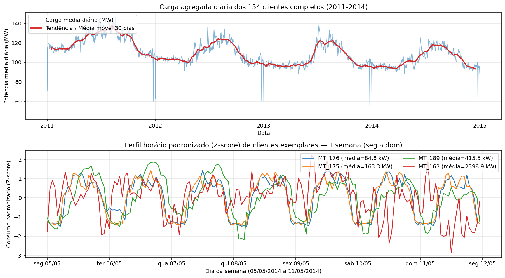
*Figura 3 — Carga agregada diária dos 154 clientes completos com média móvel de 30 dias (topo) e perfis horários padronizados em Z-score de quatro clientes representativos ao longo de uma semana típica (baixo).*

---

## 4. Etapa 1 — Agrupamento: AGNES + DTW + Silhueta

A Etapa 1 foi implementada de forma modular em [agrupamento.py](file:///home/ettore/Documentos/PUC/Temporais/Trabalho/Codigo/src/agrupamento.py) e orquestrada por [01_agrupamento.py](file:///home/ettore/Documentos/PUC/Temporais/Trabalho/Codigo/01_agrupamento.py) e [01_agrupamento.ipynb](file:///home/ettore/Documentos/PUC/Temporais/Trabalho/Codigo/01_agrupamento.ipynb). Todos os números reportados provêm de [metricas_agrupamento.json](file:///home/ettore/Documentos/PUC/Temporais/Trabalho/Resultados/metricas_agrupamento.json), [resumo_clusters_etapa1.csv](file:///home/ettore/Documentos/PUC/Temporais/Trabalho/Resultados/resumo_clusters_etapa1.csv) e [rotulos_clientes_agrupamento.csv](file:///home/ettore/Documentos/PUC/Temporais/Trabalho/Resultados/rotulos_clientes_agrupamento.csv).

### 4.1 Metodologia (DTW, Z-score e Ligação AGNES)

- **Escala e padronização:** utilizaram-se todas as **154 séries completas** na frequência **diária (`1.461` dias, de `2011-01-01` a `2014-12-31`)**. Cada série foi padronizada individualmente por **Z-score** ($\mu = 0, \sigma = 1$) antes do cálculo de distâncias. Essa normalização evita que o agrupamento apenas separe consumidores grandes de pequenos por amplitude absoluta em kW, fazendo o DTW comparar estritamente a **forma da dinâmica temporal** (tendência plurianual e sazonalidades anual e semanal).
- **Matriz de distâncias DTW com restrição de Sakoe-Chiba:** empregou-se `tslearn.metrics.cdist_dtw` com métrica L2 e banda de **Sakoe-Chiba de raio $r = 7$ dias** (equivalente a um ciclo semanal completo). A escolha da escala diária com banda de 7 dias tem dupla justificativa: (i) viabilidade computacional — os `11.781` pares únicos da matriz `154 × 154` foram computados em **11,5 s** e armazenados em cache (`Resultados/matriz_dtw_diario_154.npy`), ao passo que na escala horária bruta (`35.064` pontos) o custo quadrático seria proibitivo; e (ii) coerência temporal — impede alinhamentos espúrios entre estações distantes do ano, permitindo flexibilidade elástica apenas dentro da janela semanal (ex.: deslocamento de feriados móveis e fins de semana). A matriz resultante apresentou distância mínima não nula de `9,4054`, mediana de `23,8076`, média de `26,4464` e máxima de `71,8912`.
- **Métodos de ligação do AGNES (`average` vs. `ward`):**
  - **`average` (UPGMA):** calcula a distância entre dois grupos como a média aritmética de todas as distâncias par-a-par entre seus membros. Por operar diretamente sobre qualquer matriz de dissimilaridades pré-computada sem exigir espaço euclidiano, é a escolha **metodologicamente rigorosa** para DTW.
  - **`ward` (variância mínima):** minimiza o incremento da soma de quadrados intra-cluster pela fórmula recursiva de Lance-Williams. **Limitação metodológica declarada:** o critério de Ward pressupõe formalmente distância **euclidiana** (centróides em $\mathbb{R}^T$), condição violada pela distância DTW (que não satisfaz a desigualdade triangular). Por isso, `ward` foi avaliado **exclusivamente em caráter comparativo** ao lado de `average`.

### 4.2 Dendrogramas e Estrutura Hierárquica

A **Figura 4** compara os dendrogramas truncados nos 35 ramos superiores para ambas as ligações:
- Na ligação **`average`** (esquerda), a altura de corte que separa `k = 2` clusters está em `h = 45,3354` (isolando um bloco de `147` clientes de um grupo de `7` clientes). Para cortes abaixo dessa altura, a árvore `average` vai destacando séries individuais atípicas desse menor grupo (*singletons* sucessivos em `k = 3`, `k = 4` e `k = 5`), preservando o núcleo de 147 clientes intacto até `k = 6`.
- Na ligação **`ward`** (direita), o corte superior em `h = 127,4361` (`k = 2`) produz **exatamente a mesma partição `[147, 7]`** encontrada por `average`. Contudo, o corte imediatamente abaixo (`k = 3`, `h = 99,1977`) divide o grande bloco de 147 séries em um grupo de `13` clientes e outro de `134` clientes antes de fragmentar o núcleo principal.

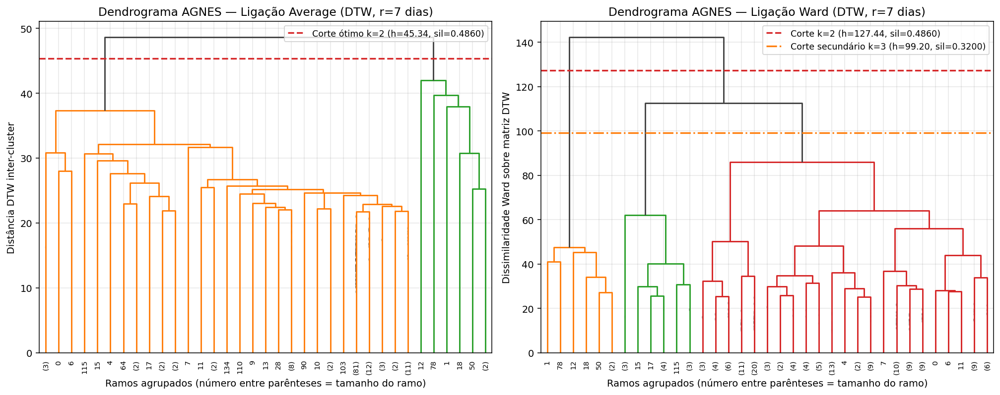
*Figura 4 — Dendrogramas AGNES sobre a matriz DTW (`r = 7` dias) para as ligações `average` (esquerda) e `ward` (direita), com as linhas tracejadas indicando os cortes analisados.*

### 4.3 Avaliação da Silhueta ($k = 2 \dots 10$) e Definição Objetiva do Corte

A tabela abaixo consolida o Coeficiente de Silhueta médio (`metric="precomputed"` sobre a matriz DTW), o número de séries com silhueta negativa e a distribuição dos tamanhos de cluster para $k = 2 \dots 10$:

| $k$ | `average`: Silhueta média | `average`: Negativos | `average`: Tamanhos dos clusters | `ward`: Silhueta média | `ward`: Negativos | `ward`: Tamanhos dos clusters |
|---|---|---|---|---|---|---|
| **2** | **0,4860** | **0** | `[147, 7]` | **0,4860** | **0** | `[7, 147]` |
| 3 | 0,4759 | 0 | `[147, 6, 1]` | 0,3200 | 3 | `[7, 13, 134]` |
| 4 | 0,4602 | 0 | `[147, 5, 1, 1]` | 0,0874 | 36 | `[7, 13, 44, 90]` |
| 5 | 0,4307 | 2 | `[147, 4, 1, 1, 1]` | 0,0768 | 35 | `[7, 13, 44, 43, 47]` |
| 6 | 0,3548 | 1 | `[5, 142, 4, 1, 1, 1]` | 0,0859 | 35 | `[7, 3, 10, 44, 43, 47]` |
| 7 | 0,2882 | 1 | `[5, 11, 131, 4, 1, 1, 1]` | 0,0710 | 27 | `[7, 3, 10, 44, 43, 29, 18]` |
| 8 | 0,2543 | 2 | `[5, 11, 130, 1, 4, 1, 1, 1]` | 0,0615 | 39 | `[7, 3, 10, 13, 31, 43, 29, 18]` |
| 9 | 0,2442 | 4 | `[3, 2, 11, 130, 1, 4, 1, 1, 1]` | 0,0646 | 43 | `[7, 3, 10, 13, 31, 18, 25, 29, 18]` |
| 10 | 0,2417 | 4 | `[3, 2, 11, 130, 1, 3, 1, 1, 1, 1]` | 0,0646 | 43 | `[2, 5, 3, 10, 13, 31, 18, 25, 29, 18]` |

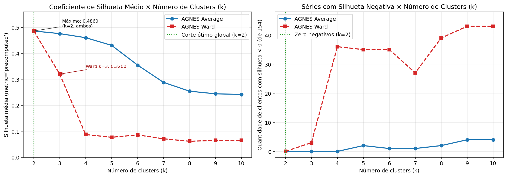
*Figura 5 — Evolução do Coeficiente de Silhueta médio (esquerda) e da quantidade de clientes com silhueta negativa (direita) para $k = 2 \dots 10$, comparando `average` e `ward`.*

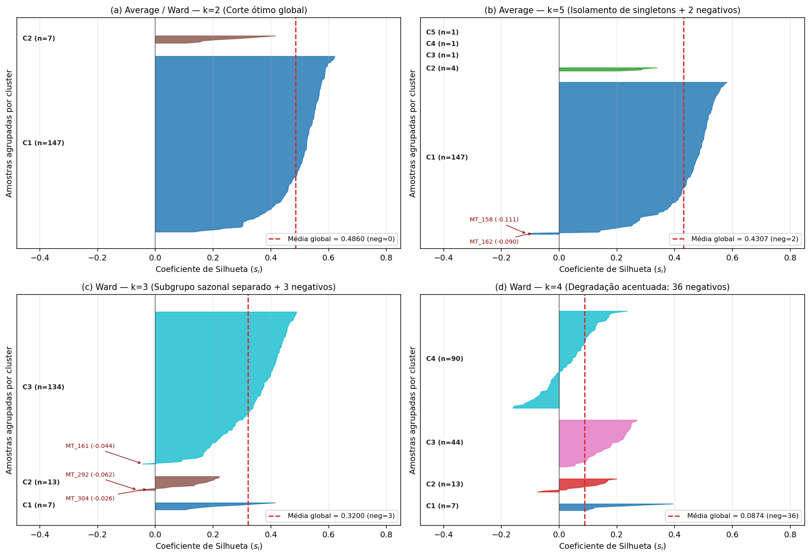
*Figura 6 — Gráficos detalhados de silhueta por amostra e por cluster em quatro cenários-chave: (a) corte ótimo global `k=2`; (b) `average k=5` com singletons e negativos; (c) `ward k=3` com separação do subgrupo de inverno; (d) `ward k=4` evidenciando o colapso estrutural.*

#### Como o gráfico de silhueta define objetivamente o ponto de corte do dendrograma

O gráfico de silhueta traduz diretamente a qualidade geométrica de cada possível altura de corte do dendrograma por meio de quatro critérios objetivos, todos visíveis nas **Figuras 5 e 6**:

1. **Máximo da silhueta média global:** o coeficiente de silhueta $s_i = (b_i - a_i) / \max(a_i, b_i)$ mede quão próxima a série $i$ está de seu próprio grupo ($a_i$) em comparação ao grupo vizinho mais próximo ($b_i$). O pico absoluto ocorre em **$k = 2$** (`0,4860` em ambas as ligações, conforme a **Figura 5**), caindo monotonicamente quando o dendrograma é cortado em alturas menores (`average`: $0,4860 \to 0,4759 \to 0,4602 \to 0,4307 \to 0,3548$; `ward`: $0,4860 \to 0,3200 \to 0,0874$).
2. **Ausência de silhuetas negativas ($s_i < 0$):** valores negativos indicam que uma série está em média mais próxima de outro cluster do que do cluster ao qual foi atribuída. Em **$k = 2$**, ambas as ligações exibem **0 amostras negativas** (**Figura 6a**). Em contraste, forçar $k = 4$ na ligação `ward` faz o número de séries mal alocadas saltar de `3` para **36** (**Figura 6d**).
3. **Validade estrutural vs. equilíbrio de tamanhos (evitar *singletons*):** na ligação `average`, embora `k = 3` e `k = 4` ainda tenham `0` negativos e silhuetas médias altas (`0,4759` e `0,4602`), a **Figura 6b** mostra que esses cortes surgem apenas porque o dendrograma isola clusters unitários (*singletons* `n = 1` com $s_i = 0$ por definição, como `MT_174`, `MT_249` e `MT_156`), sem formar novos grupos densos. Em contraste, `k = 2` evita *singletons*, mas resulta em uma partição fortemente desbalanceada (`[147, 7]`): o pico global da silhueta reflete justamente o contraste entre o núcleo majoritário (`C1`) e um pequeno nicho em expansão (`C2`), não uma divisão simétrica da base.
4. **Posição relativa à linha da média global:** idealmente todos os clusters alcançariam ou superariam a linha tracejada da média global. Em `k = 2` (**Figura 6a**), o cluster majoritário (`C1`, $n = 147$) ultrapassa a média (`0,4974 > 0,4860`), enquanto o grupo menor (`C2`, $n = 7$) permanece **abaixo** da média global (`0,2450 < 0,4860`, máximo `0,4143`), embora ainda livre de valores negativos (`s_min = 0,1054`). Já em `ward k = 4` (**Figura 6d**), a lâmina de `C4` ($n = 90$) despenca para média `0,0355` com extensa cauda negativa, indicando de forma inequívoca que o corte deve ser feito **acima** da fusão `h = 74,96`.

Assim, o critério objetivo da silhueta aponta **`k = 2` (`average`/`ward`, `h = 45,34` em `average`) como o corte principal ótimo**. Complementarmente, observa-se que o corte secundário **`ward k = 3` (`h = 99,20`, silhueta `0,3200`, apenas 3 negativos)** revela uma subdivisão fisicamente interpretável dentro do bloco majoritário (separando um pequeno subgrupo de inverno dominante), enquanto qualquer corte em $k \ge 4$ destrói a coesão intra-cluster.

### 4.4 Análise das Séries com Silhueta Negativa / Ruidosas

- **Na partição ótima (`k = 2`, `average` e `ward`):** **nenhuma série** apresentou silhueta negativa (`s_min = 0,1327` em `C1` e `0,1054` em `C2`).
- **Em `average k = 5` (2 negativos — Figura 6b):** **`MT_158` (`s = -0,1108`)** e **`MT_162` (`s = -0,0901`)**, ambos alocados no Cluster 1 (`n = 147`). Fisicamente, esses dois clientes possuem forte predominância de consumo no **inverno** (`verão/inverno = 0,830` e `0,826`), diferindo do núcleo de verão de `C1` (`verão/inverno = 1,192`); como `average` priorizou isolar os outliers de expansão (`MT_174`, `MT_249`, `MT_156`) antes de separar o subgrupo de inverno, `MT_158` e `MT_162` ficaram temporariamente negativos até serem agrupados em `k = 6` (onde passam a ter silhuetas positivas).
- **Em `ward k = 3` (3 negativos — Figura 6c):**
  - **`MT_292` (`s = -0,0619`, alocado em `C2 inverno`)** e **`MT_304` (`s = -0,0256`, alocado em `C2 inverno`)**: ambos apresentam razão sazonal praticamente neutra com leve predomínio de verão (`verão/inverno = 1,053` para os dois, conforme ilustrado para `MT_292` na **Figura 7**), situando-se na zona de transição entre o perfil de inverno (`C2`) e o de verão (`C3`).
  - **`MT_161` (`s = -0,0444`, alocado em `C3 verão`)**: apresenta consumo médio elevado (`1.774,49 kW`), razão sazonal praticamente neutra (`verão/inverno = 1,007`) e retração plurianual mais intensa que a média (`2014/2011 = 0,703`), ficando na borda com `C2`.
- **Em `ward k = 4` (36 negativos — Figura 6d):** a divisão do núcleo homogêneo de verão em dois blocos (`C3` com 44 e `C4` com 90) cria forte sobreposição de fronteira, levando 34 membros de `C4` (inclusive `MT_211 = -0,1605`, `MT_323 = -0,1586` e `MT_175 = -0,1540`) e 2 de `C2` (`MT_292` e `MT_304`) a silhuetas negativas.

### 4.5 Interpretação Física dos Clusters e Escolha da Série Representativa

| Partição | Cluster | $n$ (%) | Medóide | Silhueta média | Consumo médio (kW) | Tendência `2014/2011` (agreg. / med. cliente) | Sazonalidade `Verão/Inverno` (agreg. / med. cliente) | Razão `Útil/FDS` | Pico horário | Perfil interpretado |
|---|---|---|---|---|---|---|---|---|---|---|
| **`average_k2`** | **C1** | **147 (95,45%)** | **`MT_206`** | **0,4974** | **734,99** | **0,845 / 0,862** | **1,192 / 1,149** | **1,004** | **18h** | **Regime majoritário (pico de verão + retração 2011–2014)** |
| **`average_k2`** | **C2** | **7 (4,55%)** | **`MT_188`** | **0,2450** | **176,43** | **1,266 / 1,206** | **1,184 / 1,178** | **1,005** | **17h** | **Expansão estrutural de carga (2011–2014)** |
| `ward_k3` | C1 | 7 (4,55%) | `MT_188` | 0,2340 | 176,43 | 1,266 / 1,206 | 1,184 / 1,178 | 1,005 | 17h | Expansão estrutural (idêntico a `average_k2` C2) |
| `ward_k3` | C2 | 13 (8,44%) | `MT_267` | 0,1251 | 225,19 | 0,853 / 0,858 | 0,944 / 0,936 | 1,089 | 18h | Regime de inverno dominante / aquecimento e dias úteis |
| `ward_k3` | C3 | 134 (87,01%) | `MT_206` | 0,3434 | 784,44 | 0,844 / 0,864 | 1,200 / 1,153 | 1,001 | 18h | Núcleo de verão dominante (climatização) |

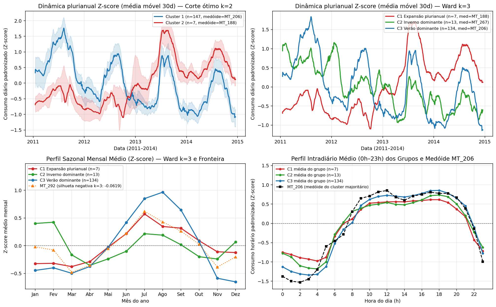
*Figura 7 — Dinâmica plurianual Z-score para `k=2` (topo esquerdo) e `ward k=3` (topo direito), perfil sazonal mensal médio destacando a inversão entre `C2` (inverno) e `C3` (verão) e a série fronteiriça `MT_292` (baixo esquerdo), e perfil intradiário médio com o medóide `MT_206` (baixo direito).*

A **Figura 7** evidencia os dois fenômenos estruturais capturados pelo DTW sobre o consumo elétrico em Portugal entre 2011 e 2014:
1. **Tendência plurianual divergente (`k = 2`):** a imensa maioria dos consumidores (`C1`, `95,45%`) apresenta redução sistemática de carga entre 2011 e 2014 (`2014/2011 = 0,845` agregada e mediana `0,862` por cliente), coerente com o período de retração econômica e eficiência energética em Portugal, enquanto `7` clientes (`C2`, `4,55%`: `MT_156`, `MT_174`, `MT_187`, `MT_188`, `MT_219`, `MT_249`, `MT_316`) crescem no período (`2014/2011 = 1,266` agregada e mediana `1,206`). Destaca-se o caso extremo de **`MT_187`**, cuja razão `2014/2011 = 10,337` (expansão de ~`5 kW` para >`50 kW`) puxa a média aritmética das razões individuais de `C2` para `2,491`, reforçando a importância de reportar a mediana por cliente (`1,206`) ao lado da razão agregada (`1,266`).
2. **Regime sazonal de verão vs. inverno (`ward k = 3`):** enquanto o núcleo de `134` clientes (`C3`) atinge pico expressivo em julho–agosto (`verão/inverno = 1,200`, típico de uso intensivo de climatização/refrigeração), um grupo de `13` clientes (`C2`, medóide `MT_267`) possui maior carga nos meses de inverno (`verão/inverno = 0,944`, especialmente janeiro–fevereiro e dezembro) e ligeira predominância em dias úteis (`1,089`).

**Seleção da série representativa para as Etapas 2 e 3:** escolhe-se o cliente **`MT_206`**, que é simultaneamente o **medóide do cluster majoritário (`C1`, 147 clientes em `k = 2`)** e do **núcleo de verão (`C3`, 134 clientes em `ward k = 3`)**, apresentando elevada silhueta (`0,5667` em `k = 2` e `0,4548` em `ward k = 3`), consumo médio de `209,22 kW`, tendência `2014/2011 = 0,862`, razão sazonal `verão/inverno = 1,199` e `0` valores ausentes em todas as escalas.

---

## 5. Etapa 2 — Matrix Profile

A Etapa 2 foi implementada de forma modular em [matrix_profile.py](file:///home/ettore/Documentos/PUC/Temporais/Trabalho/Codigo/src/matrix_profile.py) e orquestrada por [02_matrix_profile.py](file:///home/ettore/Documentos/PUC/Temporais/Trabalho/Codigo/02_matrix_profile.py) e [02_matrix_profile.ipynb](file:///home/ettore/Documentos/PUC/Temporais/Trabalho/Codigo/02_matrix_profile.ipynb), utilizando a biblioteca `stumpy` (`1.14.1`). Todos os resultados reportados abaixo provêm da execução real registrada em [metricas_matrix_profile.json](file:///home/ettore/Documentos/PUC/Temporais/Trabalho/Resultados/metricas_matrix_profile.json) e [resumo_motifs_discords_etapa2.csv](file:///home/ettore/Documentos/PUC/Temporais/Trabalho/Resultados/resumo_motifs_discords_etapa2.csv).

### 5.1 Série Representativa Selecionada (`MT_206`)

Conforme definido ao término da Etapa 1, a série escolhida é o cliente **`MT_206`**, pelas seguintes razões objetivas:
- **Representatividade estrutural (medóide):** é o medóide simultaneamente do cluster majoritário **`C1`** na partição ótima global `k = 2` (`147` de `154` clientes = `95,45%`, silhueta individual `0,5667`) e do núcleo sazonal de verão **`C3`** em `ward k = 3` (`134` clientes = `87,01%`, silhueta `0,4548`).
- **Integridade temporal:** apresenta **100,0% de cobertura** no período integral (`2011-01-01 00:00:00` a `2014-12-31 23:00:00`), `0` valores ausentes e apenas `4` células de microfalha imputadas em toda a grade de 15 minutos.
- **Estatísticas na escala horária (`35.064` horas):** consumo médio de **`209,22 kW`**, desvio-padrão de **`70,17 kW`**, mediana de **`222,79 kW`**, mínimo de **`29,50 kW`** e máximo de **`417,10 kW`**.

### 5.2 Escolha da Janela $m$ e Comparação Multi-Escala

Em séries de carga elétrica, o parâmetro de comprimento de subsequência $m$ deve refletir a **periodicidade física dominante** do sistema para evitar correspondências espúrias em frações incompletas de ciclo:

- **Janela principal (`horario_m168`, $m = 168\text{ h}$):** na série horária (`35.064` pontos), $m = 7 \times 24 = 168$ horas corresponde a **1 semana completa**. Essa janela engloba simultaneamente o ciclo diário (dia/noite) e a alternância entre dias úteis e fins de semana, sendo ideal para detectar semanas operacionais típicas (*motifs*) e quebras de calendário/feriados (*discords*).
- **Janela secundária intradiária (`horario_m24`, $m = 24\text{ h}$):** na mesma série horária, $m = 24$ horas isola um **ciclo diário único**, permitindo capturar dias específicos anômalos (ex.: feriados isolados de 24h) ou repetições pontuais de perfil diário.
- **Janela de comparação diária (`diario_m7`, $m = 7\text{ dias}$):** na série diária (`1.461` pontos), $m = 7$ dias avalia a dinâmica semanal apenas sobre as médias diárias, suavizando a forma intradiária.

| Configuração (`escala_janela`) | Janela $m$ | Subsequências ($N - m + 1$) | Zona exclusão ($\lceil m/4 \rceil$) | Tempo (`s`) | Mínimo ($d_Z$) | Mediana ($d_Z$) | p95 ($d_Z$) | Máximo ($d_Z$) |
|---|---|---|---|---|---|---|---|---|
| **`horario_m168` (principal)** | `168 h` | `34.897` | `42` | `13,468` | `1,9088` | `3,0170` | `3,7042` | `5,5415` |
| `horario_m24` | `24 h` | `35.041` | `6` | `0,487` | `0,0000` | `0,6053` | `0,9165` | `4,4254` |
| `diario_m7` | `7 dias` | `1.455` | `2` | `0,010` | `0,1115` | `0,6257` | `1,1102` | `1,6236` |

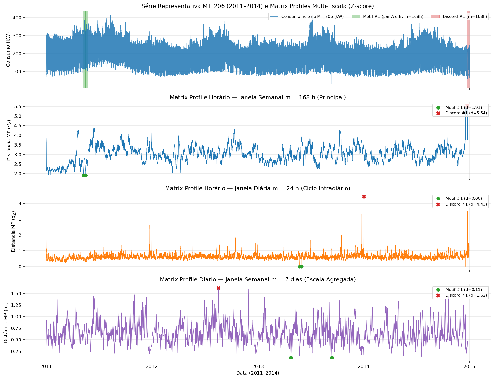
*Figura 8 — Série horária `MT_206` (topo) e comparação dos Matrix Profiles Z-normalizados para $m = 168\text{ h}$ (principal), $m = 24\text{ h}$ e $m = 7\text{ dias}$, com marcação dos respectivos Motif #1 (verde) e Discord #1 (vermelho).*

### 5.3 Identificação e Interpretação dos Motifs

Para evitar que subsequências deslocadas por poucas horas dentro da mesma semana apareçam repetidamente no ranking, os *motifs* e *discords* foram extraídos aplicando zona de exclusão de raio completo $m$ após cada ocorrência selecionada:

| Janela | Rank | Início A | Início B (par) | Distância $d_Z$ | Pearson $r$ | Média A / Média B (`kW`) | Interpretação |
|---|---|---|---|---|---|---|---|
| **`m=168h`** | **#1** | `2011-05-10 15:00` | `2011-05-17 15:00` | **`1,9088`** | **`0,9892`** | `247,67` / `249,80` | Duas semanas consecutivas de maio/2011 com rotina diurna estável |
| `m=168h` | #2 | `2011-01-08 06:00` | `2011-01-15 06:00` | `1,9168` | `0,9891` | `216,98` / `215,44` | Duas semanas consecutivas de inverno regular (jan/2011) |
| `m=168h` | #3 | `2011-02-13 22:00` | `2011-02-20 22:00` | `1,9880` | `0,9882` | `217,90` / `215,33` | Duas semanas consecutivas de fevereiro/2011 |
| `m=24h` | #1 | `2013-05-25 00:00` | `2013-06-01 00:00` | `0,0000` | `1,0000` | `204,70` / `204,70` | **Descoberta de réplica exata na base bruta** (sábados idênticos em 15 min) |
| `m=24h` | #2 | `2014-12-19 00:00` | `2014-12-26 00:00` | `0,0000` | `1,0000` | `188,34` / `188,34` | **Descoberta de réplica exata na base bruta** (sextas-feiras idênticas) |
| `m=24h` | #3 | `2011-03-08 23:00` | `2011-04-03 23:00` | `0,2514` | `0,9987` | `203,82` / `206,67` | Primeiro *motif* intradiário orgânico (curvas diárias quase idênticas) |
| `m=7d` | #1 | `2013-04-25` | `2013-09-13` | `0,1115` | `0,9991` | `189,84` / `223,55` | Mesma forma semanal em nível distinto ($\Delta\mu = 33,70\text{ kW}$) |

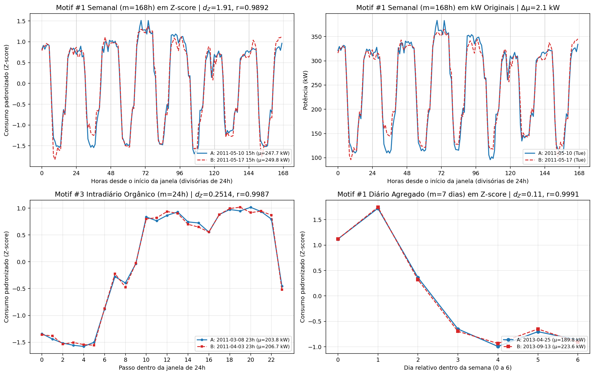
*Figura 9 — Sobreposição dos pares de motifs: janela semanal $m = 168\text{ h}$ (Motif #1 em Z-score no topo esquerdo e em kW originais no topo direito), janela intradiária $m = 24\text{ h}$ (primeiro motif orgânico #3: `2011-03-08 23h` vs. `2011-04-03 23h`, baixo esquerdo) e escala diária agregada $m = 7\text{ dias}$ (Motif #1, baixo direito).*

**Interpretação dos Motifs:**
- **Rotina semanal altamente previsível (`m = 168h`):** os três principais *motifs* semanais ocorrem em **semanas consecutivas defasadas exatamente por 168 horas** (correlação $r \ge 0,9882$). A **Figura 9** (topo) mostra o alinhamento quase perfeito entre a semana iniciada em `2011-05-10 15:00` e a semana seguinte (`2011-05-17 15:00`): patamar operacional constante entre ~08h e 22h (~`310–370 kW`), queda noturna abrupta até `100–130 kW` de madrugada e estabilidade também nos fins de semana (perfil típico de edifício/serviço ou instalação comercial de operação contínua diurna de 7 dias).
- **Auditoria automatizada de réplicas ocultas (`m = 24h`):** o *Matrix Profile* intradiário identificou dois pares com distância estritamente nula ($d_Z = 0,0000$, $r = 1,0000$): `2013-05-25` vs. `2013-06-01` e `2014-12-19` vs. `2014-12-26`. Uma verificação direta no arquivo bruto `Dados/bruto/LD2011_2014.txt` confirmou `max_abs_diff = 0,000000` em todos os 96 blocos de 15 minutos de ambos os pares — evidência de que o registrador original replicou o perfil da semana anterior na sexta pós-Natal de 2014 e em um sábado de junho de 2013. Esse resultado ilustra a capacidade do *Matrix Profile* em revelar anomalias de coleta/imputação histórica invisíveis à checagem de nulos ou timestamps.
- **Invariância à escala no nível diário (`m = 7 dias`):** o Motif #1 (`2013-04-25` vs. `2013-09-13`, $d_Z = 0,1115$, $r = 0,9991$) une uma semana de primavera (`189,84 kW`) e outra do fim do verão (`223,55 kW`) com deslocamento médio de `33,70 kW`, provando que a distância Z-normalizada reconhece padrões estruturais independentemente da estação do ano.

### 5.4 Identificação e Interpretação dos Discords (Anomalias)

| Janela | Rank | Início do Discord | Vizinho mais próximo | Distância $d_Z$ | Pearson $r$ | Média Discord (`kW`) | Interpretação física |
|---|---|---|---|---|---|---|---|
| **`m=168h`** | **#1** | `2014-12-24 00:00` | `2013-12-24 00:00` | **`5,5415`** | `0,9086` | `168,75` (mín `61,43`) | **Semana do Natal 2014:** queda total no dia 25/12 (`69,82 kW`) após véspera ainda ativa até 22h |
| `m=168h` | #2 | `2011-06-15 08:00` | `2011-06-08 08:00` | `4,4039` | `0,9423` | `236,39` (mín `126,00`) | Extensão atípica às 22h de 17/06 (`291,5 kW`) e vale acentuado na madrugada de 19/06 |
| `m=168h` | #3 | `2012-10-11 07:00` | `2012-04-19 07:00` | `4,3319` | `0,9442` | `203,31` (mín `88,77`) | Prolongamento de carga noturna às 22h (`216–229 kW`) vs. semana típica |
| **`m=24h`** | **#1** | `2014-01-01 04:00` | `2013-12-25 05:00` | **`4,4254`** | **`0,5920`** | `76,26` ($\sigma=5,09$) | **Feriado de Ano Novo 2014:** supressão completa do ciclo diurno (carga base plana) |
| `m=24h` | #2 | `2014-12-25 00:00` | `2014-11-08 16:00` | `3,4997` | `0,7448` | `69,82` ($\sigma=2,90$) | **Dia de Natal 2014:** operação fechada em carga mínima ao longo das 24h |
| `m=24h` | #3 | `2013-12-25 00:00` | `2011-01-01 04:00` | `3,3425` | `0,7672` | `71,15` ($\sigma=3,08$) | **Dia de Natal 2013:** fechamento completo com carga residual plana |
| `m=7d` | #1 | `2012-08-18` | `2014-08-28` | `1,6236` | `0,8117` | `246,60` (máx `259,86`) | Variação relativa na semana de agosto/2012 (amplificada por $\sigma$ semanal baixo, ~`5,9 kW`) |

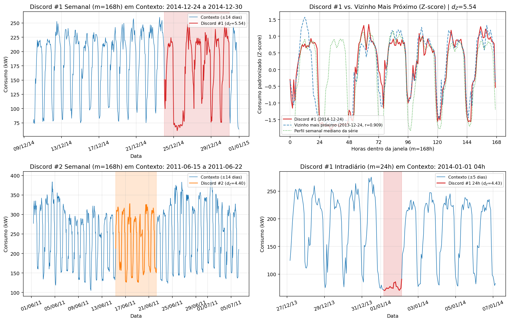
*Figura 10 — Discords em contexto e comparação de forma: Discord #1 semanal (`2014-12-24` a `2014-12-30`, topo esquerdo) e sua sobreposição Z-score contra o vizinho mais próximo (`2013-12-24`) e o perfil semanal mediano da série (topo direito); Discord #2 semanal (`2011-06-15`, baixo esquerdo); Discord #1 intradiário (`2014-01-01`, baixo direito).*

**Interpretação dos Discords:**
- **Feriados de Natal e Ano Novo como anomalias estruturais (`m = 168h` e `m = 24h`):** na **Figura 10**, o **Discord #1 semanal** (`2014-12-24 00:00` a `2014-12-30 23:00`, $d_Z = 5,5415$) coincide exatamente com a semana do Natal de 2014, quando a carga média diária despenca de `185,63 kW` (`24/12`) para **`69,82 kW`** (`25/12`), eliminando integralmente o ciclo comercial diurno (curva pontilhada verde na Figura 10, topo direito). Mesmo tendo como vizinho mais próximo o Natal do ano anterior (`2013-12-24`, $r = 0,9086$), `2014-12-24` ainda se destaca como anomalia máxima porque em `2014-12-24` houve funcionamento pleno até as `22h` (`206–217 kW`, contra `85–123 kW` em `2013-12-24`), criando transição brusca para o fechamento no dia `25/12` e retomada integral em `26/12` (dia em que ocorreu a réplica já detectada em `m=24h`). Já na janela intradiária `m = 24h`, os **três primeiros discords** correspondem exatamente aos dias de paralisação em **Ano Novo (`2014-01-01`, $d_Z = 4,4254$, $r = 0,5920$)**, **Natal 2014 (`2014-12-25`)** e **Natal 2013 (`2013-12-25`)**, nos quais a variabilidade normal ($\sigma \approx 70\text{ kW}$) colapsa para $\sigma = 2,9\text{–}5,1\text{ kW}$.
- **Desvios sutis de horário operacional (`Discord #2` e `#3` em `m = 168h`) e ressalva na escala diária (`m = 7d`):** diferentemente da parada de Natal, os discords #2 (`2011-06-15`, $d_Z = 4,4039$) e #3 (`2012-10-11`, $d_Z = 4,3319$) mantêm elevada correlação global ($r > 0,94$), mas são sinalizados por extensões pontuais de consumo às `22h` (`291,5 kW` em `2011-06-17` vs. `217,8 kW` na semana anterior) e quedas mais profundas de madrugada. Já na escala diária agregada (`m = 7 dias`), o desvio-padrão interno dentro de cada semana é pequeno (`~5–10 kW`), de modo que a normalização Z-score amplifica pequenas flutuações relativas entre dias úteis — assim, o Discord #1 de `2012-08-18` ($d_Z = 1,6236$, $\sigma = 5,93\text{ kW}$) não deve ser interpretado como anomalia operacional grave sem evidência adicional, tratando-se apenas de variação sutil na trajetória semanal.

### 5.5 Papel da Normalização Z-score no Matrix Profile

Por padrão, `stumpy.stump(..., normalize=True)` padroniza cada subsequência $X_i \in \mathbb{R}^m$ para $\hat{X}_i = (X_i - \mu_i) / \sigma_i$ antes de computar a distância euclidiana. Matematicamente, a distância Z-normalizada satisfaz a identidade exata com a correlação de Pearson $r_{X,Y}$:

$$d_Z(X, Y) = \|\hat{X} - \hat{Y}\|_2 = \sqrt{2m\left(1 - r_{X,Y}\right)}$$

Essa relação garante **invariância total a transformações afins positivas** ($Y = \alpha X + \beta$, com $\alpha > 0$), fazendo com que o *Matrix Profile* meça estritamente diferenças de **forma temporal** e não de **amplitude absoluta ou nível de base (*offset*)**. Sem essa normalização (`normalize=False`, distância euclidiana bruta), diferenças de carga sazonal entre verão e inverno dominam a métrica e produzem **falsos positivos de anomalia** em semanas normais de alta potência.

Os experimentos realizados sobre `MT_206` ($m = 168\text{ h}$) comprovam esse comportamento quantitativamente (**Figura 11**):

1. **Na série original (`MT_206`):**
   - **Sem normalização (`normalize=False`):** a distância do *Matrix Profile* apresenta forte correlação espúria com a amplitude local — **`r = 0,6513`** com o desvio-padrão $\sigma_{\text{local}}$ e **`r = 0,6372`** com a média $\mu_{\text{local}}$ da janela. Consequentemente, os maiores discords não-normalizados são dominados por janelas de elevada amplitude absoluta ou forte variação bruta, como `2011-01-01 12:00` (`494,86 kW`, $\sigma = 82,00\text{ kW}$, que inclui o feriado de Ano Novo e tem vizinho `2012-01-01` com $r = 0,9579$), a semana de pico de verão `2013-06-30 17:00` (`424,59 kW`, $\sigma = 95,77\text{ kW}$, máximo de `407,07 kW`, apesar de forma altamente similar à semana de `2011-05-21`, $r = 0,9420$) e `2011-04-17 22:00` (`381,19 kW`, $\sigma = 83,38\text{ kW}$, $r_{\text{viz}} = 0,9362$).
   - **Com normalização Z-score (`normalize=True`):** a dependência de escala desaparece (**`r = -0,1099`** com $\sigma_{\text{local}}$ e **`r = 0,0585`** com $\mu_{\text{local}}$), permitindo que a semana do Natal de 2014 (cuja amplitude é baixa, $\mu = 168,75\text{ kW}$, mas cuja *forma* é quebrada pelo fechamento atípico) emerja corretamente como **Discord #1**.
2. **Experimento controlado com perturbação afim (`1,8× + 150 kW` sobre o Motif #1):**
   - Aplicou-se a transformação $X' = 1,8 X + 150\text{ kW}$ exclusivamente sobre a janela do Motif #1 (`2011-05-10 15:00`, `idx = 3.111`), preservando exatamente sua forma temporal interna.
   - **Sem normalização:** a distância da janela salta de **`183,32 kW` para `2.486,71 kW`** (**aumento de `13,56×`**), superando em mais de `5×` o máximo original da série (`494,86 kW`). Em todo o histórico fora da zona de transição de borda da própria perturbação, nenhuma janela supera `494,86 kW` — isto é, uma simples mudança de escala/nível transforma o padrão mais típico da série em um **falso discord extremo** (ocupando o posto `#109` global apenas porque as `108` janelas adjacentes que cruzam a borda abrupta do degrau atingem até `2.696,47 kW`).
   - **Com Z-score (`normalize=True`):** a distância exatamente na janela perturbada permanece **rigorosamente inalterada em `1,9088`** (**$\Delta = 0,000000$**), mantendo a subsequência no posto de **Motif #1** global!

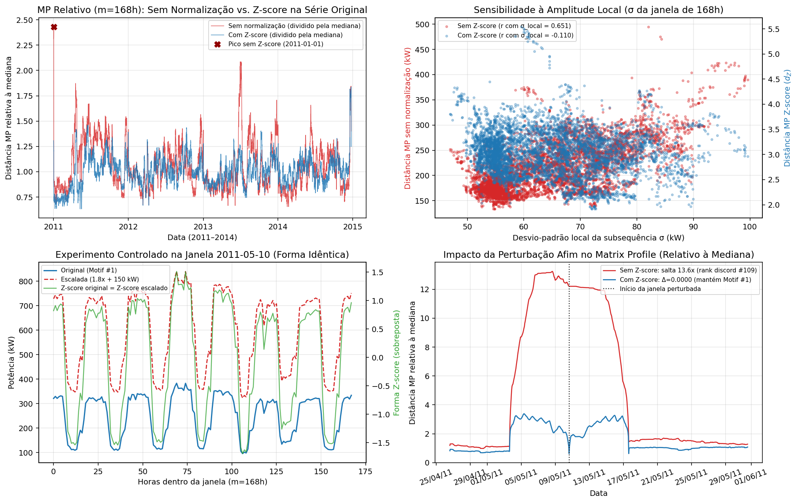
*Figura 11 — Papel da normalização Z-score no Matrix Profile (`m=168h`): comparação relativa na série original (topo esquerdo); correlação espúria com a amplitude local $\sigma$ sem Z-score vs. invariância com Z-score (topo direito); perturbação afim controlada $1,8\times + 150\text{ kW}$ sobre o Motif #1 mantendo a forma idêntica (baixo esquerdo); e impacto na distância MP comprovando $\Delta = 0,0000$ com Z-score contra salto de $13,56\times$ sem normalização (baixo direito).*

---

## 6. Etapa 3 — Modelagem Preditiva (ARIMA/SARIMAX)

A Etapa 3 foi implementada de forma modular em [arima_modelagem.py](file:///home/ettore/Documentos/PUC/Temporais/Trabalho/Codigo/src/arima_modelagem.py) e orquestrada por [03_arima.py](file:///home/ettore/Documentos/PUC/Temporais/Trabalho/Codigo/03_arima.py) e [03_arima.ipynb](file:///home/ettore/Documentos/PUC/Temporais/Trabalho/Codigo/03_arima.ipynb), utilizando `statsmodels` (`0.14.5`). Todos os números reportados provêm diretamente da execução registrada em [metricas_arima.json](file:///home/ettore/Documentos/PUC/Temporais/Trabalho/Resultados/metricas_arima.json), [tabela_adf_etapa3.csv](file:///home/ettore/Documentos/PUC/Temporais/Trabalho/Resultados/tabela_adf_etapa3.csv), [comparacao_modelos_arima_etapa3.csv](file:///home/ettore/Documentos/PUC/Temporais/Trabalho/Resultados/comparacao_modelos_arima_etapa3.csv) e [previsoes_teste_etapa3.csv](file:///home/ettore/Documentos/PUC/Temporais/Trabalho/Resultados/previsoes_teste_etapa3.csv).

A modelagem preditiva segue exatamente os oito passos metodológicos previstos no projeto, aplicando toda identificação (ACF/PACF, testes ADF e escolha de ordens) estritamente sobre o conjunto de **treino**, sem qualquer vazamento de informação (*data leakage*) do conjunto de teste.

### 6.1 Visualização da Série, Tendência, Sazonalidade e Decomposição STL

Utilizou-se a série diária regular do cliente representativo **`MT_206`** (`1.461` dias, de `2011-01-01` a `2014-12-31`, `freq='D'`, `0` nulos). A inspeção visual e a decomposição robusta **STL** (`period = 7`, janela sazonal `15`, tendência anual `365`, **Figura 12**) evidenciam quatro características estruturais:

1. **Tendência plurianual de retração e ciclo anual:** o consumo médio recua de cerca de `212–240 kW` em 2011 para `190–206 kW` em 2014, sobreposto a uma ondulação anual com máximos nos meses de verão (junho–agosto) e vales no outono/inverno.
2. **Sazonalidade semanal bem definida (`s = 7`):** o componente sazonal (painel 3 da **Figura 12**) oscila regularmente entre cerca de `-7 kW` e `+10 kW` ao longo de ciclos de 7 dias; na média do treino por dia da semana, o consumo atinge o pico na **sexta-feira (`217,58 kW`) e no sábado (`218,29 kW`)**, recuando para o mínimo semanal no **domingo (`204,81 kW`)** e mantendo patamar intermediário entre segunda e quinta (`205,89–208,56 kW`).
3. **Choques exógenos pontuais no resíduo:** os picos negativos abruptos em torno de `-100` a `-130 kW` correspondem aos feriados de fim de ano (`25/12` e `01/01`), já diagnosticados como *discords* na Etapa 2.

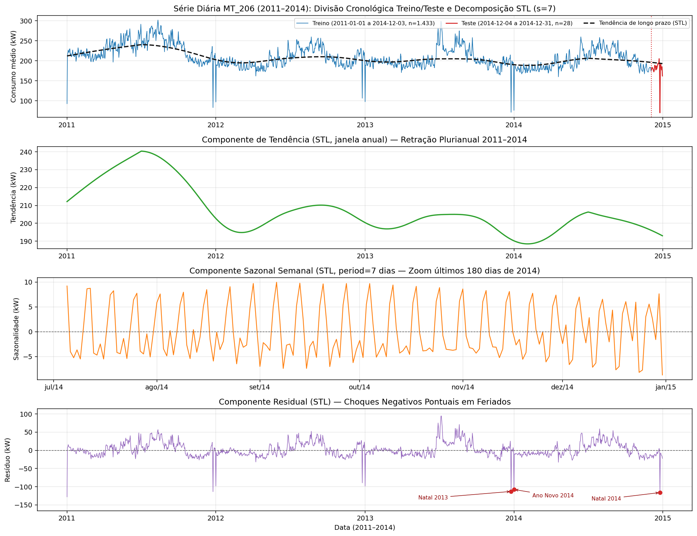
*Figura 12 — Série diária `MT_206` (`2011–2014`) com separação cronológica treino/teste (topo) e decomposição STL robusta (`period=7`): tendência anual (2º painel), sazonalidade semanal nos últimos 180 dias (3º painel) e resíduo destacando os choques negativos de Natal e Ano Novo (4º painel).*

### 6.2 Análise de ACF/PACF, Teste ADF e Diferenciação até Estacionariedade

Para definir as ordens de diferenciação $(d, D)$ sem contaminação do teste, aplicaram-se os gráficos de **ACF/PACF** (**Figura 13**) e a bateria do teste **Augmented Dickey-Fuller (ADF)** (`autolag='AIC'`) sobre o conjunto de treino (`n = 1.433` dias, reportando-se também a série completa apenas para transparência):

| Escopo | Transformação | $d$ | $D$ | Regressão | Estatística ADF | p-valor | Lags (AIC) | $N_{\text{obs}}$ | Crítico 1% | Crítico 5% | Crítico 10% | Estacionária ($\alpha=5\%$)? |
|---|---|---|---|---|---|---|---|---|---|---|---|---|
| **Treino** | **Nível ($d=0, D=0$)** | `0` | `0` | `c` | `-2,3050` | `0,1704` | `22` | `1.410` | `-3,4350` | `-2,8636` | `-2,5679` | **Não** |
| **Treino** | Nível ($d=0, D=0$) | `0` | `0` | `ct` | `-2,6402` | `0,2617` | `22` | `1.410` | `-3,9652` | `-3,4136` | `-3,1289` | **Não** |
| **Treino** | **1ª Dif. regular ($d=1, D=0$)** | `1` | `0` | `c` | **`-11,4357`** | **`6,35e-21`** | `21` | `1.410` | `-3,4350` | `-2,8636` | `-2,5679` | **Sim** |
| **Treino** | Dif. sazonal ($d=0, D=1, s=7$) | `0` | `1` | `c` | `-9,3511` | `8,29e-16` | `21` | `1.404` | `-3,4350` | `-2,8636` | `-2,5679` | **Sim** |
| **Treino** | **Dif. composta ($d=1, D=1, s=7$)** | `1` | `1` | `c` | **`-15,0192`** | **`1,03e-27`** | `22` | `1.402` | `-3,4350` | `-2,8636` | `-2,5679` | **Sim** |
| Completa | Nível ($d=0, D=0$) | `0` | `0` | `c` | `-2,2167` | `0,2003` | `22` | `1.438` | `-3,4349` | `-2,8636` | `-2,5678` | Não |
| Completa | Dif. composta ($d=1, D=1, s=7$) | `1` | `1` | `c` | `-14,1791` | `1,94e-26` | `24` | `1.428` | `-3,4349` | `-2,8636` | `-2,5678` | Sim |

- **Diagnóstico em nível ($d = 0, D = 0$):** a ACF decai muito lentamente (permanecendo acima de `0,57` até o lag `28` com elevações nos múltiplos de `7`), e o teste ADF não rejeita a hipótese nula de raiz unitária tanto com constante (`ADF = -2,3050, p = 0,1704`) quanto com constante e tendência (`ADF = -2,6402, p = 0,2617`). Conclui-se que a série em nível é **não estacionária**.
- **Após 1ª diferença regular ($d = 1, D = 0$):** o teste ADF rejeita fortemente a raiz unitária (`ADF = -11,4357, p = 6,35e-21`). Contudo, a **Figura 13** (linha do meio) revela picos sazonais positivos persistentes e significativos na ACF exatamente nos múltiplos de `7` (`lag 7 = +0,417`, `lag 14 = +0,213`, `lag 21 = +0,232`, `lag 28 = +0,221`), confirmando que a diferença simples isolada não remove a sazonalidade semanal.
- **Após diferenciação composta ($d = 1, D = 1, s = 7$):** a estatística ADF aprofunda-se para **`-15,0192`** (**$p = 1,03 \times 10^{-27}$**), eliminando a tendência e a sazonalidade determinística. Na **Figura 13** (linha inferior), observam-se: (i) corte negativo na ACF e decaimento gradual na PACF nos lags iniciais (`1` e `2`), sugerindo termos não-sazonais de baixa ordem ($p \in \{1, 2\}, q \in \{1, 2\}$); e (ii) dois picos negativos claros nos dois primeiros múltiplos sazonais da ACF (`lag 7 = -0,291` e `lag 14 = -0,200`) acompanhados por decaimento gradual negativo na PACF (`lags 7, 14, 21, 28`), assinatura clássica de um termo **MA sazonal de ordem $Q = 2$** ($P = 0$) ou de combinação $(P=1, Q=1)$ com período $s = 7$.

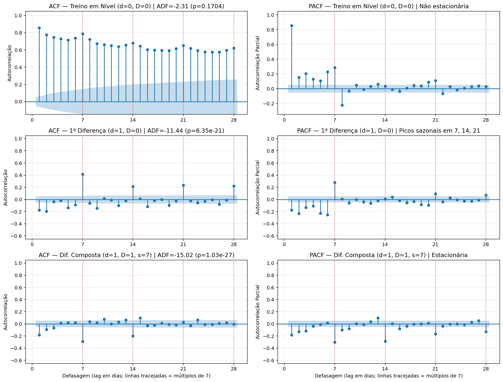
*Figura 13 — Funções ACF e PACF no conjunto de treino: em nível (`d=0, D=0`, topo), após primeira diferença regular (`d=1`, meio, destacando picos sazonais em 7, 14, 21 e 28) e após diferença composta (`d=1, D=1, s=7`, baixo), acompanhadas das respectivas estatísticas ADF.*

### 6.3 Separação Cronológica Treino/Teste

Antes de ajustar qualquer parâmetro, a série foi particionada cronologicamente (sem embaralhamento):
- **Conjunto de treino (`98,08%`):** `2011-01-01` a `2014-12-03` (`1.433` dias; média `209,80 kW`, desvio-padrão `27,53 kW`).
- **Conjunto de teste (`1,92%`):** `2014-12-04` a `2014-12-31` (`28` dias = `4` semanas completas; média `179,64 kW`, desvio-padrão `23,02 kW`).

### 6.4 Ajuste e Seleção do Modelo ARIMA/SARIMAX

Com base nos padrões observados na ACF/PACF da série estacionária ($d=1, D=1, s=7$), avaliaram-se treze especificações candidatas sobre o treino (três ARIMA não-sazonais para controle e dez SARIMA com período $s = 7$). O teste de Ljung-Box foi aplicado descontando corretamente os graus de liberdade consumidos pelos parâmetros estimados (`model_df = p + q + P + Q`):

| Modelo Candidato | `model_df` | AIC | BIC | HQIC | LB $p$ (lag 7) | LB $p$ (lag 14) | LB $p$ (lag 28) | Ruído Branco ($\alpha=5\%$)? | MAE Teste (28d) |
|---|---|---|---|---|---|---|---|---|---|
| `ARIMA(1,1,1)` | `2` | `11.456,86` | `11.472,66` | `11.462,76` | `0,0000` | `0,0000` | `0,0000` | Não | `10,90` |
| `ARIMA(2,1,2)` | `4` | `11.435,42` | `11.461,75` | `11.445,25` | `0,0000` | `0,0000` | `0,0000` | Não | `11,06` |
| `ARIMA(7,1,1)` | `8` | `11.220,02` | `11.267,42` | `11.237,72` | `N/A` ($\text{gl}\le 0$) | `0,0058` | `0,0000` | Não | `10,64` |
| `SARIMA(1,1,1)(0,1,1)_7` | `3` | `11.163,86` | `11.184,91` | `11.171,72` | `0,0000` | `0,0000` | `0,0000` | Não | `10,56` |
| `SARIMA(2,1,1)(0,1,1)_7` | `4` | `11.165,64` | `11.191,94` | `11.175,46` | `0,0000` | `0,0000` | `0,0000` | Não | `10,53` |
| `SARIMA(1,1,2)(0,1,1)_7` | `4` | `11.165,63` | `11.191,94` | `11.175,46` | `0,0000` | `0,0000` | `0,0000` | Não | `10,52` |
| **`SARIMA(1,1,1)(0,1,2)_7` (Escolhido)** | **`4`** | **`11.060,79`** | **`11.087,10`** | **`11.070,62`** | **`0,1611`** | **`0,5264`** | **`0,2458`** | **Sim** | `9,37` |
| `SARIMA(1,1,1)(1,1,1)_7` | `4` | `11.072,25` | `11.098,56` | `11.082,08` | `0,0486` | `0,1022` | `0,0545` | Não (marginal lag 7) | `9,31` |
| `SARIMA(1,1,1)(2,1,1)_7` | `5` | `11.066,04` | `11.097,61` | `11.077,83` | `0,0565` | `0,4517` | `0,0872` | Sim | `9,35` |
| `SARIMA(1,1,1)(1,1,2)_7` | `5` | `11.062,64` | `11.094,21` | `11.074,43` | `0,0608` | `0,3232` | `0,1773` | Sim | `9,41` |
| `SARIMA(2,1,1)(1,1,1)_7` | `5` | `11.073,51` | `11.105,08` | `11.085,30` | `0,0271` | `0,0965` | `0,0602` | Não | `9,23` |
| `SARIMA(1,1,2)(1,1,1)_7` | `5` | `11.073,44` | `11.105,01` | `11.085,23` | `0,0284` | `0,1005` | `0,0624` | Não | `9,22` |
| `SARIMA(2,1,2)(1,1,1)_7` | `6` | `11.074,97` | `11.111,80` | `11.088,72` | `0,0122` | `0,0908` | `0,0564` | Não | `9,13` |

**Justificativa da escolha de `SARIMA(1,1,1)(0,1,2)_7`:**
1. **Alinhamento direto com ACF/PACF:** conforme visto na **Figura 13** (linha inferior), a série diferenciada ($d=1, D=1, s=7$) possui picos negativos significativos em dois múltiplos sazonais na ACF (`lag 7 = -0,291` e `lag 14 = -0,200`) e decaimento na PACF sazonal, indicando diretamente $Q = 2$ em vez de $Q = 1$.
2. **Mínimo global de AIC/BIC e parcimônia:** `SARIMA(1,1,1)(0,1,2)_7` atinge os **menores valores de AIC (`11.060,79`), BIC (`11.087,10`) e HQIC (`11.070,62`)** dentre todas as 13 especificações avaliadas, reduzindo o AIC em `396,07` pontos frente ao `ARIMA(1,1,1)` e em `11,46` pontos frente ao `SARIMA(1,1,1)(1,1,1)_7` (que, com a correção `model_df = 4`, apresenta rejeição marginal de ruído branco no lag 7 com `p = 0,0486`).
3. **Significância estatística de todos os parâmetros:** todos os quatro coeficientes estruturais de `SARIMA(1,1,1)(0,1,2)_7` são altamente significativos ($p < 10^{-109}$): `ar.L1 = 0,5904` ($SE=0,0149, z=39,73$), `ma.L1 = -0,9181` ($SE=0,0144, z=-63,73$), `ma.S.L7 = -0,6670` ($SE=0,0099, z=-67,41$), `ma.S.L14 = -0,3082` ($SE=0,0138, z=-22,32, p=2,42\times 10^{-110}$) e $\hat{\sigma}^2 = 134,52$ ($SE=1,66$). Em comparação, `SARIMA(1,1,1)(1,1,2)_7` inclui um termo `ar.S.L7 = -0,0381` estatisticamente redundante ($p = 0,5481$), e `SARIMA(1,1,1)(2,1,1)_7` possui AIC/BIC maiores e p-valores de Ljung-Box mais próximos do limite (`p = 0,0565` no lag 7).

### 6.5 Diagnóstico de Resíduos (Ruído Branco)

Os resíduos do `SARIMA(1,1,1)(0,1,2)_7` foram avaliados após os `15` passos iniciais de *burn-in* do filtro de Kalman ($N = 1.418$ resíduos, **Figura 14**):

- **Média próxima de zero:** $\bar{e} = -0,5476\text{ kW}$ (`4,8%` do desvio-padrão residual $s_e = 11,3507\text{ kW}$ e `-0,26%` da média da série), sem tendência temporal visível no gráfico de resíduos padronizados (**Figura 14**, topo esquerdo).
- **Ausência de autocorrelação (Teste de Ljung-Box com `model_df = 4`):** quase todas as barras da ACF residual permanecem dentro das bandas de confiança de 95% até o lag `28`, com apenas os lags `21` e `23` tangenciando/ultrapassando ligeiramente o limite (**Figura 14**, baixo direito — proporção compatível com o esperado ao acaso em 28 lags a $\alpha = 5\%$). Com os graus de liberdade devidamente descontados (`gl = lag - 4`), o teste de Ljung-Box **não rejeita $H_0$ de ausência de autocorrelação em nenhum horizonte avaliado**:
  - `lag = 7` (`gl = 3`): $Q = 5,1500$, **$p = 0,1611$**
  - `lag = 14` (`gl = 10`): $Q = 9,0605$, **$p = 0,5264$**
  - `lag = 21` (`gl = 17`): $Q = 19,4791$, **$p = 0,3017$**
  - `lag = 28` (`gl = 24`): $Q = 28,3435$, **$p = 0,2458$**
- **Normalidade aproximada e ressalva das caudas pesadas:** o histograma e a curva KDE (**Figura 14**, topo direito) mostram distribuição central simétrica e concentrada em torno de zero, mas **leptocúrtica** (pico mais estreito e caudas mais pesadas que a $\mathcal{N}(0,1)$), levando o teste de **Jarque-Bera** a rejeitar normalidade estrita ($JB = 25.945,83$, $p < 10^{-16}$). No gráfico **Q-Q** (**Figura 14**, baixo esquerdo), os desvios concentram-se exclusivamente nos extremos ($|z| > 3$), que correspondem aos choques de fechamento e retomada nos **feriados de Natal e Ano Novo** (2011, 2012 e 2013) já identificados como *discords* na Etapa 2.

**Conclusão do diagnóstico:** os resíduos do `SARIMA(1,1,1)(0,1,2)_7` comportam-se como **ruído branco não-autocorrelacionado** (Ljung-Box corrigido $p \ge 0,1611$ em todos os lags), validando a especificação linear e sinalizando apenas que os intervalos de confiança gaussianos são conservadores nos dias úteis normais e subestimam choques pontuais de feriados extremos.

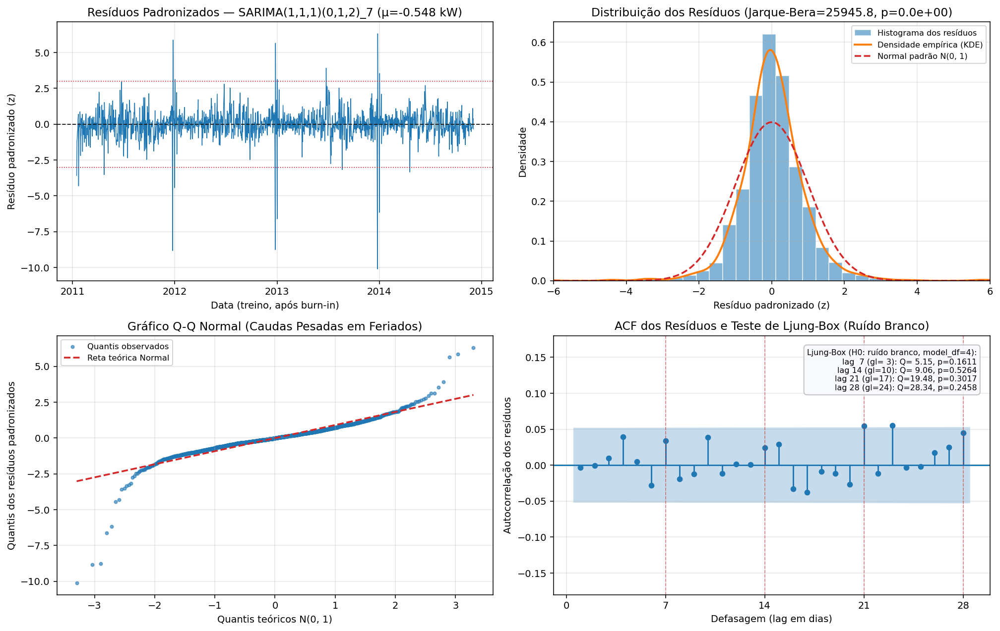
*Figura 14 — Diagnóstico de resíduos do `SARIMA(1,1,1)(0,1,2)_7`: resíduos padronizados ao longo do treino (topo esquerdo), histograma + KDE vs. $\mathcal{N}(0,1)$ (topo direito), gráfico Q-Q Normal evidenciando caudas pesadas nos feriados (baixo esquerdo) e ACF residual com estatísticas de Ljung-Box corrigidas (`model_df=4`) comprovando ruído branco (baixo direito).*

### 6.6 Previsão no Horizonte de Teste com IC 95% e Comparação com Baselines

A **Figura 15** apresenta a previsão fora da amostra para os `28` dias reservados de teste (`2014-12-04` a `2014-12-31`), acompanhada dos intervalos de confiança de `95%` e da comparação frente ao `ARIMA(1,1,1)` sem sazonalidade e aos três *baselines*:

| Modelo / Baseline | MAE (28d) | RMSE (28d) | MAPE (28d) | sMAPE (28d) | Cobertura IC 95% (28d) | *Post hoc* MAE (27d s/Natal) | *Post hoc* RMSE (27d s/Natal) | *Post hoc* MAPE (27d s/Natal) |
|---|---|---|---|---|---|---|---|---|
| **`SARIMA(1,1,1)(0,1,2)_7`** | **`9,3655`** | `22,0093` | **`8,47%`** | **`6,13%`** | **`96,43%`** | **`5,7165`** | `8,4402` | **`3,06%`** |
| `ARIMA(1,1,1)` (s/ sazonalidade) | `10,9024` | `22,6080` | `9,35%` | `6,96%` | `96,43%` | `7,2517` | `9,2838` | `3,89%` |
| Baseline Sazonal Naive ($s=7$) | `9,7374` | **`20,9383`** | `8,52%` | `6,34%` | — | `6,2862` | **`7,8952`** | `3,38%` |
| Baseline Média Móvel 7d | `10,7011` | `22,6043` | `9,27%` | `6,84%` | — | `7,0188` | `8,9854` | `3,77%` |
| Baseline Naive (último valor) | `13,8518` | `23,2342` | `10,74%` | `8,65%` | — | `10,4967` | `12,4829` | `5,60%` |

**Interpretação equilibrada dos resultados preditivos:**
- **Vitória em MAE/MAPE/sMAPE vs. derrota em RMSE frente ao *Sazonal Naive*:** o `SARIMA(1,1,1)(0,1,2)_7` supera o `ARIMA(1,1,1)` não-sazonal e todos os três *baselines* em **MAE (`9,37 kW` vs. `9,74` a `13,85 kW`)**, **MAPE (`8,47%`)** e **sMAPE (`6,13%`)** nos `28` dias completos, reduzindo o erro absoluto médio em `32,4%` frente ao *Naive* simples e em `14,1%` frente ao `ARIMA(1,1,1)`. Por outro lado, o **Baseline Sazonal Naive ($s=7$) vence em RMSE** tanto na janela completa (`20,94` vs. `22,01 kW`) quanto sem o Natal (`7,90` vs. `8,44 kW`), porque erros quadráticos penalizam fortemente dois desvios pontuais: (i) no choque exógeno do Natal (`25/12/2014`, `69,82 kW` real), o *Sazonal Naive* repetiu `172,74 kW` contra `~177,8 kW` do SARIMA; e (ii) nos dias `21–23/12` (pico comercial pré-Natal, até `205,20 kW`), o modelo estacionário retraiu gradualmente na direção da tendência média recente enquanto o *Sazonal Naive* manteve valores mais altos.
- **Análise de sensibilidade *post hoc* (exclusão de `2014-12-25`) e cobertura do IC 95%:** em análise *post hoc* após observar o erro do teste, constata-se que o dia de Natal (`25/12/2014` — o mesmo choque detectado como Discord #1 na Etapa 2) foi o único ponto fora do intervalo de confiança de `95%`, resultando em cobertura empírica global de **`96,43%`** (`27` de `28` dias). Excluindo esse feriado determinístico (que um modelo univariado sem variável exógena de calendário não pode antecipar), a cobertura nos `27` dias regulares é de **`100,0%`**, e o `SARIMA(1,1,1)(0,1,2)_7` reduz o MAE para **`5,72 kW`** (`MAPE = 3,06%`) frente a `6,29 kW` (`3,38%`) do *Sazonal Naive*.

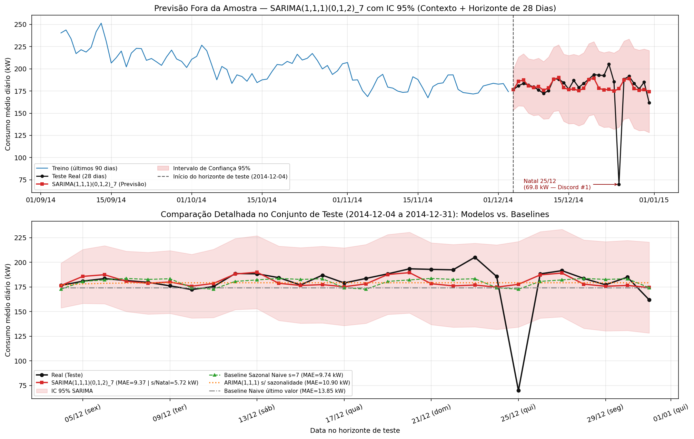
*Figura 15 — Previsão fora da amostra (`2014-12-04` a `2014-12-31`): visão contextual com IC de 95% destacando o choque do Natal de 25/12 (topo) e comparação detalhada de `SARIMA(1,1,1)(0,1,2)_7`, `ARIMA(1,1,1)` e *baselines* sobre o conjunto de teste (baixo).*

---

## 7. Conclusões e limitações

### 7.1 Síntese integrada dos resultados
O pipeline executado de ponta a ponta demonstrou forte coerência física e estatística entre todas as etapas do barema:

1. **Preparação dos dados:** a auditoria da base *ElectricityLoadDiagrams20112014* (`51.894.720` células) evitou erros metodológicos graves — separando `10.039.214` zeros estruturais de inatividade (`pré-adesão` e `pós-desligamento`) de consumo nulo real e corrigindo as anomalias sistemáticas do horário de verão europeu de 2012–2014 em março e outubro — consolidando `154` séries completas sem valores ausentes nas escalas horária (`freq='h'`) e diária (`freq='D'`).
2. **Agrupamento (DTW + AGNES + Silhueta):** a matriz DTW com banda de Sakoe-Chiba ($r = 7$ dias) sobre séries Z-normalizadas revelou uma partição de máxima silhueta em **$k = 2$** (`silhueta média = 0,4860`, `0` negativos), distinguindo a maioria dos consumidores em trajetória de retração plurianual (`C1`, `n = 147`, `2014/2011 = 0,845`) de um pequeno nicho em expansão (`C2`, `n = 7`, `2014/2011 = 1,266`), ainda que de forma desbalanceada (`C2` com silhueta `0,2450`). O corte secundário em `ward k = 3` (`0,3200`) identificou ainda `13` clientes de perfil predominantemente de inverno (`verão/inverno = 0,944`). O medóide majoritário **`MT_206`** foi eleito de maneira objetiva para as análises univariadas subsequentes.
3. **Matrix Profile (`stumpy`):** a análise em **`MT_206`** com janela semanal ($m = 168\text{ h}$) identificou rotinas semanais altamente estáveis (*Motif #1* com $r = 0,9892$) e detectou a semana do **Natal de 2014 (`2014-12-24`)** como principal anomalia (*Discord #1*, $d_Z = 5,5415$). Na escala intradiária ($m = 24\text{ h}$), além de isolar Ano Novo e Natal nos três maiores discords, o método revelou **duas réplicas exatas de 24h já existentes no arquivo bruto da UCI** (`2013-05-25`/`2013-06-01` e `2014-12-19`/`2014-12-26`, $d_Z = 0,0000$). O experimento controlado de perturbação afim ($1,8\times + 150\text{ kW}$) provou empiricamente que a normalização Z-score mantém a distância estritamente invariante ($\Delta = 0,0000$), evitando falsos discords induzidos por amplitude ($13,56\times$ sem normalização).
4. **Modelagem preditiva (`SARIMA`):** após comprovar não-estacionariedade em nível (`ADF p = 0,1704`) e estacionariedade com diferenciação regular e sazonal semanal (`d=1, D=1, s=7`, `ADF p = 1,03e-27`), o modelo **`SARIMA(1,1,1)(0,1,2)_7`** obteve os menores AIC (`11.060,79`) e BIC (`11.087,10`), gerou resíduos compatíveis com **ruído branco** mesmo após a correção de graus de liberdade do Ljung-Box (`model_df = 4`, $p \ge 0,1611$ até lag 28) e alcançou erro médio absoluto de **`9,37 kW`** em 28 dias (**`5,72 kW`** e **`MAPE = 3,06%`** em análise *post hoc* nos 27 dias fora do feriado de Natal), com `96,43%` de cobertura global do IC de 95% (embora superado em RMSE pelo *Sazonal Naive*).

### 7.2 Limitações declaradas e trabalhos futuros
- **Imputação limitada na preparação:** `65.454` células (`0,1261%` da base total, e apenas `395` células nos 154 clientes completos) foram imputadas por interpolação temporal; adicionalmente, o próprio arquivo bruto original contém dias replicados pelo registrador (como observado em `MT_206` em `2013-06-01` e `2014-12-26`).
- **Aproximações no agrupamento DTW:** o uso da escala diária com banda de Sakoe-Chiba ($r = 7$ dias) viabilizou o cálculo exato em `11,5 s`, mas abstrai diferenças finas de curva horária intradiária; além disso, a ligação de `ward` sobre distâncias DTW viola formalmente o pressuposto euclidiano, tendo sido mantida apenas em caráter comparativo à ligação `average`.
- **Caudas pesadas e ausência de variáveis exógenas de calendário no ARIMA:** os resíduos do `SARIMA(1,1,1)(0,1,2)_7` são não-autocorrelacionados (ruído branco), porém rejeitam normalidade estrita no teste de Jarque-Bera em razão das quedas extremas em feriados fixos (`25/12` e `01/01`). Em extensão futura (*SARIMAX*), a inclusão de variáveis *dummy* para feriados nacionais portugueses e efeitos térmicos exógenos permitiria capturar esses choques determinísticos e reduzir o erro quadrático médio.

---

## 8. Referências

- TRINDADE, Artur. **ElectricityLoadDiagrams20112014**. UCI Machine Learning Repository, 2015. Disponível em: <https://archive.ics.uci.edu/dataset/321/electricityloaddiagrams20112014>. DOI: `10.24432/C58C86`. Licença: CC BY 4.0.
- SAKOE, Hiroaki; CHIBA, Seibi. Dynamic programming algorithm optimization for spoken word recognition. **IEEE Transactions on Acoustics, Speech, and Signal Processing**, v. 26, n. 1, p. 43–49, 1978.
- ROUSSEEUW, Peter J. Silhouettes: a graphical aid to the interpretation and validation of cluster analysis. **Journal of Computational and Applied Mathematics**, v. 20, p. 53–65, 1987.
- TAVENARD, Romain et al. **tslearn**, A Machine Learning Toolkit for Time Series Data. Journal of Machine Learning Research, v. 21, n. 118, p. 1–6, 2020.
- VIRTANEN, Pauli et al. **SciPy 1.0**: Fundamental Algorithms for Scientific Computing in Python (`scipy.cluster.hierarchy`). Nature Methods, v. 17, p. 261–272, 2020.
- YEH, Chin-Chia Michael et al. Matrix Profile I: All Pairs Similarity Joins for Time Series: A Unifying View That Includes Motifs, Discords and Shapelets. **IEEE International Conference on Data Mining (ICDM)**, p. 1317–1322, 2016.
- LAW, Sean M. **STUMPY**: A Powerful and Scalable Python Library for Time Series Data Mining. **Journal of Open Source Software**, v. 4, n. 39, p. 1504, 2019.
- BOX, George E. P.; JENKINS, Gwilym M.; REINSEL, Gregory C.; LJUNG, Greta M. **Time Series Analysis: Forecasting and Control**. 5. ed. Hoboken: John Wiley & Sons, 2015.
- SEABOLD, Skipper; PERKTOLD, Josef. **statsmodels**: Econometric and Statistical Modeling with Python. **Proceedings of the 9th Python in Science Conference**, p. 92–96, 2010.
